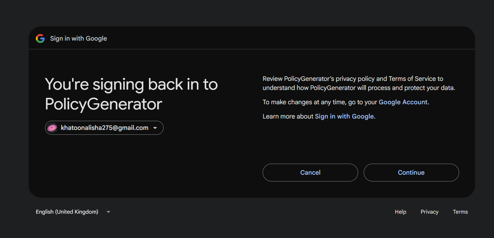
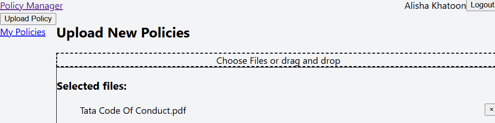
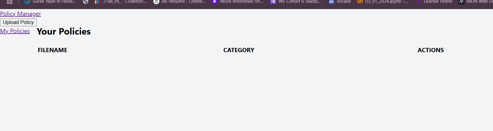
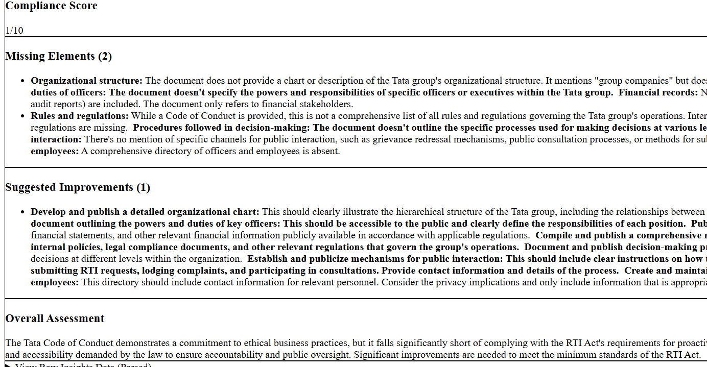
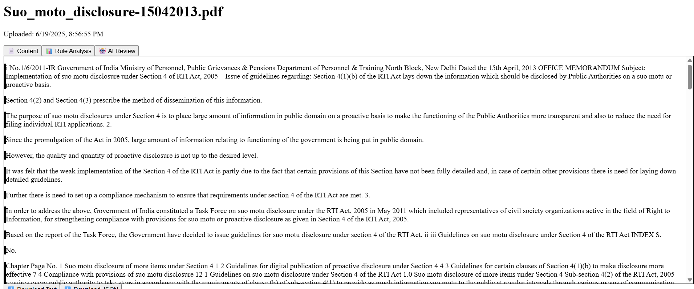

# 🧠 AI-Powered Policy Analyzer..

This is a full-stack enterprise-grade **Policy Management & Compliance Review System** built using **React (Vite)** on the frontend and **FastAPI** on the backend. It allows enterprises to **log in via Google**, upload policy documents (PDFs), and receive **AI-powered compliance analysis** aligned with current Indian government standards (e.g., RTI, MSME guidelines)...


## 🚀 Features

- 🔐 **Secure Google Login**
- 📤 **Multi-policy Upload** via drag-and-drop or file chooser
- 🤖 **AI-Powered Review**:
  - Compliance Score (out of 10)
  - Detected Missing Elements
  - Suggested Improvements
- 📄 **Content & Rule Analysis View**
- 📊 Smart dashboard (coming soon)


## 🔍 Use Case

This tool is especially useful for **enterprises**, **HR/legal teams**, and **MSMEs** that need to:

- Ensure internal policies are aligned with government frameworks
- Quickly assess compliance gaps
- Improve policy quality with AI suggestions


## 🖼️ App Screenshots

### 🔐 1. Google OAuth Login



### 📤 2. Upload Policy Interface



### 📄 3. Document View & Tabbed Analysis



### 📊 4. AI Review with Compliance Score



### 📁 5. My Policies Dashboard




## 🛠 Tech Stack

**Frontend:** React + Vite + Tailwind  
**Backend:** FastAPI + PostgreSQL  
**Auth:** Google OAuth 2.0  
**AI Integration:** Gemini / LLM APIs  
**Storage:** SQLAlchemy, UUID file naming  
**Deployment Ready:** Docker + Production builds planned


## 📦 Local Development...

### Backend (FastAPI)

```bash
cd backend
python -m venv venv
source venv/bin/activate  # On Windows: venv\Scripts\activate
pip install -r requirements.txt
uvicorn main:app --reload
